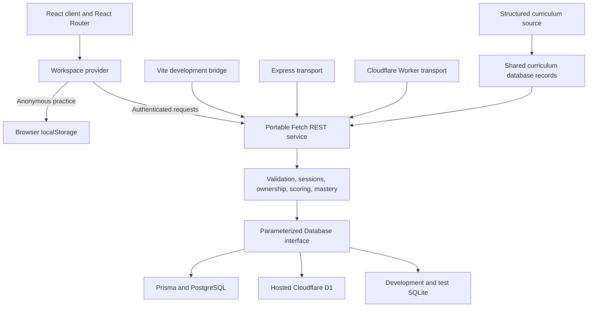

# CoreLab architecture

CoreLab separates curriculum, user-specific learning records, presentation, and transport. The same REST service runs in three environments through a small database interface.

## Frontend

`src/main.tsx` mounts React Router and the workspace provider. `src/App.tsx` supplies desktop navigation, the mobile drawer, search, theme controls, and route selection. Page modules own the dashboard, learning screens, practice, saved library, and account forms. Small reusable UI controls live in `src/components/`.

`src/lib/store.tsx` is the client action boundary. Pages call actions such as saving a note or submitting an attempt instead of making independent ad hoc requests. Authenticated actions call the REST API and refresh authoritative account state. Anonymous actions update an explicitly labeled browser-local practice workspace. Signing in selects the server workspace; signing out restores the separate practice workspace.

`shared/types.ts` documents data contracts consumed by content, services, and the frontend. `src/lib/metrics.ts` derives presentation statistics from actual saved records. Server-side checks decide mastery and quiz scores for authenticated users; display calculations cannot grant access to another user's records or claim a server score.

## Backend and database adapters

`server/api.ts` accepts standard Fetch `Request` objects and returns `Response` objects. It handles consistent response envelopes, validation, route selection, authentication, owner-scoped queries, attempt recording, assessment scoring, and revision updates. `server/security.ts` contains password derivation, secure token helpers, sessions, request parsing, and shared errors.

`server/db.ts` defines `prepare`, bound statement execution, and atomic `batch`. This is the only database capability the service requires. Query values remain bound separately from SQL templates.

| Runtime | Transport | Persistence |
| --- | --- | --- |
| Conventional local or self-hosted | Express bridge in `server/express.ts` | Prisma/PostgreSQL when `DATABASE_URL` is set. |
| Managed Sites | `server/worker.ts` | Provisioned Cloudflare D1 through the `DB` binding. |
| Convenient local preview | Vite development middleware or Express | Persistent `node:sqlite` database under `work/`. |
| Integration tests | Direct calls to `handleApi` | Isolated in-memory SQLite with the real migration. |

Prisma's PostgreSQL adapter uses parameterized raw-query methods behind this interface. The SQL templates are authored by the application; user input is passed as parameters. This avoids maintaining separate scoring and authorization implementations for each host. It does not mean that D1 is PostgreSQL or that Prisma itself is the hosted D1 runtime.

## Relational model

Shared catalog tables are separate from learner ownership:

- `Subject → Module → Topic → LearningMaterial / Checkpoint` holds editable structured educational content.
- `User → Session / PasswordReset` manages login and single-use recovery credentials.
- `UserTopicProgress` has one record per user/topic combination, including learning status and next-review information.
- `CheckpointAttempt` preserves each submission, answer, nullable correctness, level, and timestamp.
- `Quiz` stores an account-owned assessment inventory; `QuizAttempt` stores scored results and answer history.
- `Bookmark` and `UserNote` are unique per user/topic.
- `RevisionHistory` retains completed reviews; `LearningActivity` retains real learning events.
- `RateLimit` supplies database-backed authentication attempt buckets.

Foreign keys prevent dangling references. Unique constraints prevent duplicate progress, bookmarks, notes, and repeat quiz results where relevant. Related writes use atomic batches: for example an attempt and its activity event commit together. No protected operation accepts a request-supplied owner as authority.

## Curriculum lifecycle

Editable initial records live under `content/`; JSON stores data without executable UI logic. The content loaders produce `Subject[]` and `Topic[]` using the shared contract. Every topic contains explanations, an example, interview preparation, revision points, references, and checkpoints. Several representative advanced scenarios include Hard multiple-choice questions alongside descriptive practice, so every subject supports a Hard quiz.

`server/curriculum.ts` seeds missing subject, module, topic, material, and checkpoint records. An empty migrated installation is seeded on first use; schema creation never occurs inside hosted request handling. `scripts/seed.ts` exposes the same data-only seed for local administration. Existing rows are preserved intentionally. Updating a source lesson is not an implicit overwrite of editorial database content.

When changing an existing lesson, preserve its stable id and coordinate updates to structured topic data, learning material, and checkpoints. Removing a question affects historical references and mastery denominators; plan that editorial change rather than silently replacing identifiers.

The curriculum is an educational draft with independent linked references. Technical review can be performed and recorded separately; the repository does not claim that generated educational text has already received independent human review.

## Progress, assessment, and mastery

Opening material records learning activity. Completed represents deliberate learning completion; Mastered requires evidence. The latest response to each checkpoint determines current difficulty performance while all earlier attempts remain available as history. Free text has no automatic semantic grader: a learner explicitly compares against the reference and self-assesses it.

Default mastery thresholds are Easy 100%, Medium 80%, Hard 70%, and a topic assessment of at least 80%. Every available checkpoint at each level must have graded evidence. A qualifying topic assessment must cover the topic's complete automatically scored question set. A partial hand-selected quiz cannot establish mastery. The server recalculates topic state as evidence or thresholds change; recent mistakes can identify revision needs.

Server-started assessments persist the selected randomized question inventory and timestamps before displaying questions. Submissions are scored against canonical answers. Missing answers count as incorrect, duplicate answers are rejected, and replaying a completed assessment returns its recorded result. Timed UI behavior does not make client-provided scores authoritative.

Revision intervals are 1, 3, 7, 14, and 30 days. Completing a review records history and advances the schedule. The readiness indicator combines completion, checkpoint performance, quiz performance, mastery, and revision coverage; it describes learning evidence rather than predicting hiring outcomes.

## Authentication and runtime configuration

Password storage uses salted PBKDF2-SHA-256 with a versioned hash format. Raw passwords are never stored. Session bearer tokens are random; only their hashes and expiration are stored server-side. Cookies are HttpOnly and SameSite=Lax, with Secure on HTTPS. Mutation requests require JSON and pass browser-origin checks.

Password resets use hashed, expiring, single-use tokens and revoke sessions on success. Resend configuration enables production delivery. Without it, production returns an explicit delivery-configuration error. Only development mode can reveal a reset URL for local testing.

Environment variables stay on the server. `.env.example` documents local values; shell commands in the README explicitly load the file because API code reads `process.env`. Hosted secrets are configured in the runtime rather than compiled into React.

## Builds and migrations

Vite produces `dist/client`. `scripts/build-worker.ts` collects those verified assets and bundles `server/worker.ts` with an immutable asset map into `dist/server/index.js`. The Worker serves the client and `/api` on the same origin. The standalone Express server serves the same built client directly from disk.

`drizzle/` contains D1/SQLite schema history and its journal. `prisma/schema.prisma` and `prisma/migrations/` describe PostgreSQL. New structural changes must update the corresponding histories for both deployment targets. Keep migrations schema-only; content updates belong in explicit seed or editorial operations. `.openai/hosting.json` retains the existing Site identity and declares the hosted database binding.

## Verification boundaries

`npm test` exercises the actual service and relational constraints with isolated SQLite databases. It covers authentication, user isolation, sessions and reset tokens, checkpoint correctness, assessment integrity, mastery, and relational behavior. Typechecking and building validate shared contracts and packaging. Browser QA checks navigation, responsiveness, accessibility interactions, and actual flows.

A passing SQLite suite does not establish that a live PostgreSQL instance, production email provider, or every possible browser has been verified. Configure and exercise those deployment-specific integrations when operating them. SQL lesson queries are reference material; the app does not provide a sandbox for executing arbitrary learner SQL.
